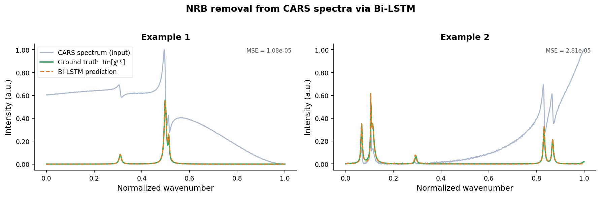

# Vibrational Spectroscopy Research: A Deep Learning Approach

This repository documents PhD research conducted at LUT University (Computational Physics) on applying deep learning to automate spectroscopic signal processing — specifically, extracting the pure Raman signal from Coherent Anti-Stokes Raman Scattering (CARS) spectra.

The core challenge: CARS spectra contain a strong Non-Resonant Background (NRB) that distorts the underlying Raman signal. Traditional retrieval methods require manually tuned parameters and domain expertise. This research replaces that manual process with trained neural networks — CNN, Bi-LSTM, LSTM, and autoencoder architectures — that generalise across experimental conditions.



**Key results across the project series:**
- Fine-tuned CNN achieving **86% prediction accuracy** on semi-synthetic data, with superior performance over the baseline model on experimental spectra
- Hyperparameter-optimised SpecNet reaching **~96% accuracy**, with mean-squared error **~60x lower** than the unoptimised baseline
- Bi-LSTM outperforming CNN, LSTM, and VECTOR autoencoder on both synthetic and experimental spectra — the first application of Bi-LSTM to CARS spectroscopy
- 4 peer-reviewed publications

---

## Projects

### Paper 1 — Effect of NRB Type on CNN Performance
`Folder: NRBs_on_extraction_of_Raman_signals_from_CARS_spectra/`

Investigated how the choice of synthetic NRB during training data generation affects a CNN's ability to generalise to experimental spectra. Three NRB shapes were tested: product of two sigmoids, single sigmoid, and fourth-order polynomial. The polynomial-trained model showed the strongest line-shape extraction and best agreement with ground truth — establishing that upstream data engineering decisions critically determine model performance.

**Key finding:** Polynomial NRB training yields the best generalisation to experimental spectra.

Scripts: `RSS_Advances_CNN_to_train_with_different_NRBs.py`, `RSS_Advances_CNN_prediction_on_test_data.py`
Weights: 3 x .h5 files included in repo.

**Paper:** [Effect of non-resonant background on the extraction of Raman signals from CARS spectra using deep neural networks](https://pubs.rsc.org/en/content/articlehtml/2022/ra/d2ra03983d) — *RSC Advances*, 2022

---

### Paper 2 — Four Deep Learning Architectures Compared
`Folder: Four_DL_models_comparison/`

Introduced Bi-LSTM to CARS spectroscopy for the first time and benchmarked it against three architectures: LSTM, CNN (SpecNet-based), and VECTOR (a very deep convolutional autoencoder). All models were trained on data synthesised with three NRB types. The Bi-LSTM consistently outperformed the others on both synthetic and experimental spectra.

**Key finding:** Bi-LSTM outperforms CNN, LSTM, and VECTOR on all metrics — the strongest model in this domain.

Scripts: `LSTM_train.py`, `bi-LSTM_train.py`
> **Note:** The VECTOR training script is not included in this repo. VECTOR model weights are available on request (see below).

**Paper:** [Evaluating different deep learning models for efficient extraction of Raman signals from CARS spectra](https://pubs.rsc.org/en/Content/ArticleLanding/2023/CP/D3CP01618H) — *Physical Chemistry Chemical Physics*, 2023

---

### Paper 3 — Fine-tuning a Pre-trained CNN (Finetuned SpecNet)
`Folder: Finetuned_SpecNet/`

Applied transfer learning to adapt the pre-trained SpecNet CNN to two sets of semi-synthetic CARS spectra. The fine-tuned model achieved 86% prediction accuracy on semi-synthetic data and outperformed the original SpecNet on four experimental CARS spectra. Also characterised model sensitivity to noise — performance degrades non-linearly with increasing noise level.

**Key finding:** 86% accuracy on semi-synthetic data; superior to baseline SpecNet on experimental spectra.

Notebook: `Hyperoptimized_SpecNet.ipynb`

**Paper:** [Semi-synthetic data generation to fine-tune a convolutional neural network for retrieving Raman signals from CARS spectra](https://opg.optica.org/optcon/fulltext.cfm?uri=optcon-1-11-2360) — *Optics Continuum*, 2022

---

### Paper 4 — Hyperparameter Optimisation of SpecNet
`Folder: Hyperparameter_Optimization_of_CNN/`

The baseline SpecNet model could not accurately recover spectral peaks near the edges of the spectral range, nor match peak intensities throughout the spectrum. Systematic hyperparameter optimisation (Bayesian search via Optuna) produced a refined architecture that resolved both failure modes.

**Key finding:** ~96% accuracy with MSE ~60x lower than the unoptimised baseline.

Notebook: `Hyperoptimized_SpecNet.ipynb`

**Paper:** [On the relevance of hyperparameter optimization of convolutional neural networks for retrieving spectral signals](https://opg.optica.org/optcon/fulltext.cfm?uri=optcon-3-8-1461) — *Optics Continuum*, 2024

---

## Publications

| Paper | Journal | Year |
|-------|---------|------|
| [Effect of non-resonant background on the extraction of Raman signals from CARS spectra using deep neural networks](https://pubs.rsc.org/en/content/articlehtml/2022/ra/d2ra03983d) | *RSC Advances* | 2022 |
| [Semi-synthetic data generation to fine-tune a convolutional neural network for retrieving Raman signals from CARS spectra](https://opg.optica.org/optcon/fulltext.cfm?uri=optcon-1-11-2360) | *Optics Continuum* | 2022 |
| [Evaluating different deep learning models for efficient extraction of Raman signals from CARS spectra](https://pubs.rsc.org/en/Content/ArticleLanding/2023/CP/D3CP01618H) | *Physical Chemistry Chemical Physics* | 2023 |
| [On the relevance of hyperparameter optimization of convolutional neural networks for retrieving spectral signals](https://opg.optica.org/optcon/fulltext.cfm?uri=optcon-3-8-1461) | *Optics Continuum* | 2024 |

Authors (all papers): Junjuri R., Saghi A., Lensu L., Vartiainen E.M.
Full publication list: [Google Scholar — Ali Saghi](https://scholar.google.com/citations?user=GcWhnFcAAAAJ&hl=en)

---

## Technical Stack

| Category | Details |
|----------|---------|
| Framework | TensorFlow 2.7, tensorflow.keras |
| Architectures | CNN (SpecNet-based), Bi-LSTM, LSTM, VECTOR (convolutional autoencoder) |
| Hyperparameter tuning | Bayesian optimisation via Optuna |
| Data | Simulated CARS spectra (3 NRB types: polynomial, single sigmoid, two-sigmoid product); experimental CARS spectra (available on request) |
| Language | Python 3, tested in Spyder |

```bash
pip install -r requirements.txt
```

---

## Data & Weights Availability

The 300 synthetic test spectra (`x_test_300_merge_spectra3.npy`, `y_test_300_merge_spectra3.npy`) are included. Trained weights for CNN, LSTM, and Bi-LSTM are included as `.h5` files.

> **Experimental CARS spectra and VECTOR model weights** are available on request — contact [Erik M. Vartiainen](https://research.lut.fi/converis/portal/detail/Person/56843) (LUT University).

---

## Connect

- **Google Scholar:** [Ali Saghi](https://scholar.google.com/citations?user=GcWhnFcAAAAJ&hl=en)
- **LinkedIn:** [ali-saghi-fabric](https://www.linkedin.com/in/ali-saghi-fabric/)
- **Blog:** [lotusoftware.hashnode.dev](https://lotusoftware.hashnode.dev) — current work in Microsoft Fabric, Power BI, and agentic analytics engineering